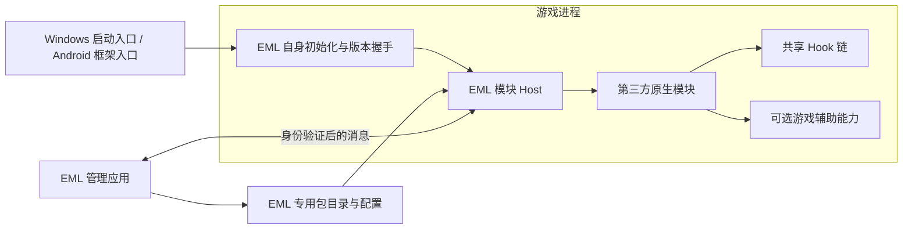

# 加载机制调研：复用范围与产品边界

日期：2026-10-10。状态：设计建议，尚未实现 EML 游戏入口或新 ABI；没有启动、注入或部署游戏。

## 结论

原第三方模块加载核心可以保留。模块生命周期、依赖排序、不可变安装代次、配置/消息/日志与网页隔离已有实现，适合逐步迁移和验证。兼容原 BE 已发行模块包是硬要求：旧 ZIP、原生库和网页脚本无需修改或重新编译，Next 不在兼容范围内。产品入口和内部代码可以改造，对外旧契约由兼容层保留，不能靠全局替换前缀完成。

改名可以建立新的产品和接口身份，不能证明反作弊不会关联 BE 与 EML。结构体成员名通常不会进入优化后的机器码；改导出名、包名或签名也不改变加载和游戏操作的行为。现有反作弊的记录和归因规则没有可验证依据，本文不提供不被关联的保证。

## 已确认的实现事实

| 层 | 当前机制 | 迁移判断 |
| --- | --- | --- |
| 模块包 | `module.json`、双端二进制、网页入口、默认配置、依赖；导入限制和路径校验 | 原 format 1 / ABI 1 包原样接受，不强制新增 EML 标记 |
| 原生模块 Host | Windows `LoadLibraryExW`；Android `dlopen`；固定导出查询和版本/结构大小校验 | 可复用，仍是目标进程内执行 |
| 生命周期 | 初始化、配置变化、消息、关闭在 Host worker 串行执行 | 保留；不等于 Unity 主线程 |
| 更新与停用 | DLL/SO 驻留；停用收尾；更换已加载代次报告需重启 | 保留；停用不能约束恶意模块自行运行的线程和补丁 |
| 通信 | 带 token 的 loopback 服务、有界消息/事件队列、模块身份绑定网页桥 | 可复用协议设计；应用和 Host 必须同步切换新契约 |
| 可选能力 | `runtime`、`get_runtime`、`hooks` 可以为空 | 纯加载 Host 不必携带 BE 内置功能或全部游戏解析器 |
| Windows 游戏入口 | BE 默认显式启动后加载 Bootstrap；另有 XInput 代理和手动映射分支 | 推荐首版显式启动及标准系统加载；不整包搬入旧注入器 |
| Android 游戏入口 | libxposed API 102、框架远程文件、游戏私有代次、JNI 注册及 linker namespace 接入 | 保留整体流程；包名、入口、桥接类、目录与 JNI 绑定需要成套迁移 |

原模块 Host 见 [third_party_host.cpp](../native/shared/third_party_modules/third_party_host.cpp)，接口见 [ThirdPartyModule.h](../native/shared/include/BetterEndfieldNext/ThirdPartyModule.h)。原集成文件保存在 [provenance/integration](../provenance/integration/)，迁入来源与 SHA-256 见 [迁移清单](../provenance/migration.json)。

需要特别区分：模块的 ABI 检查发生在 OS 已加载 DLL/SO 之后。DLL 的 `DllMain` 或 SO 构造函数可能已经执行。因此元数据、入口和结构体校验是兼容性检查，不能证明模块无越界行为。任意原生模块仍拥有所在游戏进程的访问能力。

## 原样加载核心的独立验证

[独立研究工程](../research/loading-core/CMakeLists.txt) 只编译迁入的第三方 Host、原测试宿主与 Echo DLL，不链接 BE Host、内置模块、游戏解析器或游戏二进制。

```powershell
cmake -S research/loading-core -B build/research/loading-core -A x64
cmake --build build/research/loading-core --config Release
python native/tests/third_party_host_test.py --host build/research/loading-core/Release/EModLoaderHostProbe.exe --library build/research/loading-core/Release/example.echo.dll
```

本机 Windows Release 构建及原回归通过，验证了：

- 原生 DLL 加载、消息回复和事件；`runtime_helper_ready` 为 false。
- loopback 身份验证、配置变化、停用/重新启用。
- 已加载安装代次更新时报告需重启；UI-only 包处理。
- 停止宿主后重新使用同一 endpoint。

这证明纯模块加载核心能脱离 BE 运行，不代表已完成 EML 产品、Android 独立加载，或第一人称的游戏内验证。

## 推荐架构



EML Host 只负责装载、生命周期、通信、能力查询和 Hook 协调。第一人称作为示例模块注册，不作为 Host 内置相机开关。BE 与 EML 不共用已运行的 Host，也不让其中一方依赖另一方安装。

## 命名与兼容性

以下名称是建议，尚未写入生产代码。

| 对象 | 建议 |
| --- | --- |
| Windows Host / 启动程序 | `EModLoader.Host.dll` / `EModLoader.Launcher.exe` |
| C API | 内部使用 EML 名称；兼容层保留旧 C ABI 与 `BetterEndfield_GetThirdPartyModuleV1` 查询 |
| Android | 新的 applicationId、桥接类和 native library；不复用 BE 的 Provider authority |
| 用户配置 | EML 专用根目录；不读取 BE 的启用列表和 token |
| 网页 API | 对旧模块继续提供 `window.betterEndfield` 和 `better-endfield.module-ui.v1`；内部桥可采用 EML 名称和独立 profile |
| 模块包 | 接受已发行 format 1 / ABI 1；作者 ID、包内路径和业务配置保留；新版本协议另行显式协商 |
| 签名 | 产品各用稳定的发布证书；这是发行身份，不能视为运行行为隔离 |

成员名称改变且布局/调用约定不变时，C ABI 可以仍然兼容；导出查询名、JSON key 和网页协议改变则影响旧消费者。按照兼容要求，原已发行模块包无需重新编译或更新网页桥：E Mod Loader 在边界处接收旧接口，再转入新的内部服务。Next 导出和网页 API 不作为支持目标。保留作者自己的业务配置字段，例如模块的 `label`。

新内部能力设计可以把通用生命周期与可选游戏辅助接口分开。但旧 `BE_ThirdPartyHostV1`、`BE_ThirdPartyModuleV1`、`BE_HostApiV1` 和 `BE_HookChainApiV1` 的布局、调用约定、返回码和行为必须由适配层维持。可选能力未就绪只证明基础装载可用，不能据此宣称依赖游戏辅助的旧模块已兼容。新增功能通过另外协商的能力扩展，不改写 V1 布局。

## 游戏接入与重复初始化

Windows 首版建议显式启动和标准 `LoadLibrary` 路径，先验证自有 Host 的启动、状态返回和重复加载处理。XInput 自启动代理可以作为后续选项，单独实现安装/卸载和已有代理识别。当前 BE 注入器遇到游戏目录已有 `xinput1_4.dll` 会拒绝启动，这条保护要保留其语义。

不要把旧启动器默认、XInput、自定义映射等全部分支一次性迁入。不同分支需要不同的启动时序和测试；本文没有证据表明其中某一方式可避免反作弊记录。

Android 可继续采用现有框架接入路径，但必须验证 framework API、游戏进程范围、文件发布、游戏私有副本、类加载器/JNI 注册、Unity namespace 和 16 KiB 页面支持。仅更换 SO 名称不能解决这些归属问题。

按用户最新选择，不实现 BE/EML 跨产品互斥，不增加共用锁、占用标记或互相识别的握手；EML 不依赖 BE 的配合或安装状态。两者同时使用的兼容性不作承诺。

EML 仍应保证自身 Host/JNI 不重复初始化，同一个启用模块不重复进入生命周期。同一目标的多个 EML 模块通过自己的共享 Hook 链协调。这些是本产品内部的生命周期约束。

两个独立 Hook 实现修改同一函数，不一定使游戏崩溃：可能返回挂钩失败、形成某种后继调用链、因 ABI/时序不一致而破坏行为，或在更晚时刻才出错。崩溃不是可靠冲突检测；不主动制造崩溃，也不把游戏仍运行当作已兼容的证据。跨产品重复加载与行为不受 EML Host 的链管理覆盖。

当前 Android 的 `started` 和 BE 专用 `flock` 可作为自身重复装载保护的参考，迁入 EML 时采用 EML 自己的状态和归属路径，不与 BE 共用。DLL/SO 驻留、停用与更新需重启的规则继续保留。

## 第一人称示例

原 [第一人称归档](../examples/first-person/README.md) 包含相机、MMD、音乐、姿态占用与模型几何辅助的集成快照，不能把整个 `module.cpp` 当成第一人称插件直接编译。

拆分顺序：保留专用 CPU 网格/角色骨骼资料和恢复规则；整理独立第一人称状态；提取必需的游戏绑定、主线程更新和 Hook；适配 EML 生命周期与消息；移除不需要的自由相机/MMD 等依赖。是否支持与模型替换配合需要单独设计可选几何接口，不能默认依赖 BE 已加载。

至少验证退出恢复、切人/模型变化、主相机变化、主线程限制、网格与资源所有权、暂时无法恢复时的重试，以及停用后的回调收尾。旧归档测试结果不能替代新模块的验证。

## 建议开发顺序

1. 建立正式独立构建与旧包兼容层，先运行已发行、未重新编译的 Echo 包，再运行新项目示例。保留原样迁入文件作为可核对来源，改造后的实现放新维护目录。
2. 完成管理应用、包导入/更新/排序、配置、网页桥与状态/日志，不要求先进入游戏。
3. Windows 单一启动路径、EML Host 握手和自身重复初始化保护；再验证游戏内 Echo。
4. Android 框架入口、资源发布和 native 接入，明确测试设备与框架版本。
5. 第一人称示例模块化与游戏内验证；之后再考虑额外加载模式。

实际实现前不需要把成熟模块加载核心全部重写。需要保证产品依赖和接口边界成立，并接受保留源码会保留代码关联这一事实。

## 平台资料

- Microsoft：[LoadLibraryExW](https://learn.microsoft.com/en-us/windows/win32/api/libloaderapi/nf-libloaderapi-loadlibraryexw)。用于核对系统加载与搜索路径语义，不构成反作弊兼容承诺。
- Microsoft：[Dynamic-Link Library Best Practices](https://learn.microsoft.com/en-us/windows/win32/dlls/dynamic-link-library-best-practices)。入口在 loader lock 下执行，新入口应尽量简单，把常规初始化与日志等移至 worker。
- Android：[JNI tips](https://developer.android.com/training/articles/perf-jni)。用于核对 JNI 注册和 class loader 归属；原框架和游戏 namespace 接入仍需要实测。
